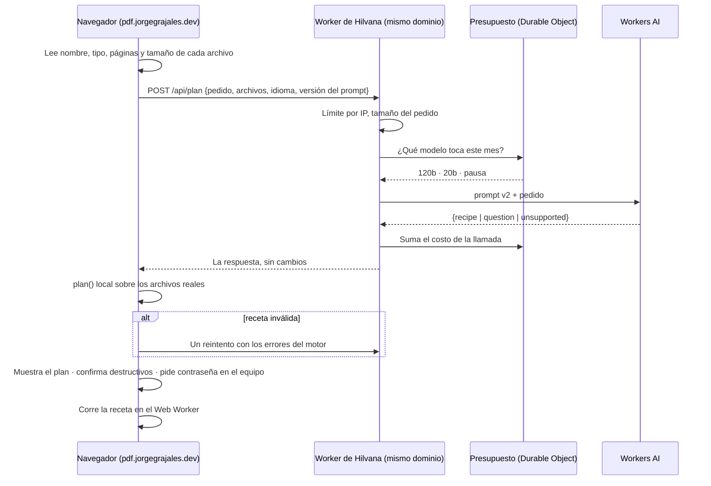

# Agente integrado en la web · Diseño

Estado: **propuesta**, 26 de noviembre de 2026. Implementa la decisión D9b del PRD (sección 9.4) con los resultados de [agent-benchmark.md](agent-benchmark.md). Las decisiones que quedan abiertas están al final (D19 a D22).

*Integrated web agent: design proposal. The person describes a task in words; a model turns it into a recipe from names, kinds and page counts only; the recipe is shown and runs in the browser.*

## 1. Qué hace

La persona carga sus archivos en la web, escribe lo que quiere ("une estos tres, quita la página 2 y ponle número a las páginas") y recibe un **plan**: los pasos en lenguaje simple, con los destructivos marcados. Al confirmar, el plan corre en el navegador, igual que cualquier herramienta de hoy. Si el plan no le sirve, la persona puede abrirlo en la herramienta de recetas y ajustarlo a mano.

El agente **planea, no ejecuta**. El documento nunca sale del equipo: el modelo solo recibe el pedido y, por cada archivo, su nombre, tipo, número de páginas, tamaño y si es escaneado o está protegido.

## 2. Flujo

1. **El navegador arma la consulta** con lo que ya sabe de cada archivo. Es el mismo formato que usa el arnés (`userMessage` en `bench/agent/prompt.mjs`).
2. **El Worker de Hilvana** recibe la consulta en `/api/plan`, en el mismo dominio. La política de seguridad de la web (`connect-src 'self'`) no cambia, y no se agrega ningún script de terceros.
3. **El Worker elige el modelo** según el gasto del mes (sección 4), llama a Workers AI por el binding `AI`, sin token, y devuelve la respuesta tal cual. No guarda el pedido ni la respuesta, y no los escribe en registros.
4. **El navegador valida** la respuesta con `plan()` sobre los archivos reales. Si el motor la rechaza, hace **un** reintento, enviando solo los mensajes de error del motor, que no traen contenido de los documentos. Si vuelve a fallar, ofrece las herramientas manuales.
5. **Según la respuesta:**
   - **Receta:** el navegador muestra el plan. Los pasos destructivos piden confirmación, como hoy. Si la respuesta trae `passwordOnDevice`, el campo de contraseña aparece en la página y la contraseña nunca sale del equipo.
   - **Pregunta:** se muestra y la persona responde. La segunda consulta lleva el pedido, la pregunta y la respuesta; no hay historial más largo.
   - **No soportado:** se muestra el motivo y la herramienta manual más cercana, si existe.

## 3. Qué viaja y qué no

| Viaja al Worker y al modelo | No viaja nunca |
|---|---|
| El pedido escrito (máximo 500 caracteres) | Bytes de ningún archivo |
| Por archivo: nombre, tipo, páginas, tamaño en KB, `scanned`, `protected` | Texto, imágenes o metadatos internos de las páginas |
| Idioma y versión del prompt | Contraseñas (las de entrada y las del resultado se escriben en el equipo) |
| En el reintento: los mensajes de error de `plan()` | Identificadores de persona, cookies, analítica |

Los **nombres de archivo** pueden traer datos personales ("extracto Juan Pérez.pdf"). El modelo los necesita para pedidos como "en orden cronológico" o "primero el anexo". La sección 8 deja la decisión abierta (D19).

En el **Worker**, la observabilidad queda apagada, como hoy (`observability.enabled: false`). El código no registra cuerpos de petición, y el presupuesto solo guarda totales del mes (sección 4).

En **Workers AI**, Cloudflare no retiene el contenido ni entrena con él (PRD, sección 9.4). La página de privacidad debe decir esto, nombrar los modelos y enlazar la política de Cloudflare antes de activar el agente.

## 4. Enrutador y tope de gasto

| Gasto del mes (uso, sin los USD 5 de Workers Paid) | Modelo | Por qué |
|---|---|---|
| Menos del 80 % del tope | gpt-oss-120b | 96,4 % de acierto, p95 de 9 s |
| Del 80 % al 100 % | gpt-oss-20b | 94,4 % de acierto a 56 % del costo |
| Tope alcanzado | Ninguno: el agente se pausa hasta el mes siguiente | Las herramientas manuales siguen funcionando |

- **El presupuesto** vive en un Durable Object con un contador por mes. Cada respuesta de Workers AI trae los tokens usados; el Worker los convierte a dólares con los precios de `models.json` y los suma. El tope inicial es USD 10 (D9b). Cloudflare no ofrece un tope duro de gasto para Workers AI, solo alertas, así que este contador es la única protección real.
- **Si el contador falla**, el Worker no llama al modelo. Ante la duda, se pausa; nunca gasta sin poder contar.
- **Tiempo de espera:** 20 s con 120b; si se vence, un intento con 20b. Groq (escenario B) queda como respaldo de disponibilidad, para cuando se active su cuenta con retención cero (D22).
- **Capacidad con el tope de USD 10:** unos 8.300 planes al mes con 120b, sumando la capa gratis de unos 68 planes diarios. Supuesto: unos 3.800 tokens de entrada y 350 de salida por plan, como midió el arnés.

## 5. Cuota por persona sin rastrear a nadie

El PRD fija 30 planes gratis al mes por persona (sección 12), pero la web no tiene cuentas, y D13 dice que no envía nada que identifique a nadie. Hay tres mecanismos posibles:

| Mecanismo | Qué protege | Costo para la privacidad |
|---|---|---|
| **Tope global** (sección 4) | El bolsillo de Hilvana, sin importar quién gaste | Ninguno |
| **Límite por IP** (Rate Limiting de Cloudflare, por ejemplo 10 planes por hora) | Un abuso concentrado desde una conexión | Cloudflare ve la IP en cualquier caso; no se guarda nada |
| **Contador en el navegador** (30 al mes, en el almacenamiento local) | Muestra a cada persona su cupo | Ninguno; es fácil de saltar, pero el tope global sigue mandando |

Propuesta: usar las tres. El cupo de 30 es una guía honesta, no un candado; el candado real es el tope global. Una alternativa más fuerte sería Turnstile, el reto anti-bots de Cloudflare, pero exige cargar un script de terceros y rompe la política de seguridad de la web. Queda descartada mientras exista otra opción (D20).

## 6. Un solo contrato para el arnés y el producto

El prompt, el esquema filtrado y el lector de respuestas pasan de `bench/agent/prompt.mjs` y `grade.mjs` a `@hilvana/recipes`, como un módulo `planner`: `systemPrompt`, `userMessage`, `plannerSchema`, `parseAnswer`, `PROMPT_VERSION`. Tanto el Worker como el arnés importan de ahí, así que lo que se mide es exactamente lo que corre.

Reglas:

- **Ningún cambio al prompt sin arnés:** cambiar `PROMPT_VERSION` obliga a correr el corpus principal y los reservados con el modelo principal. Se publica solo si ambos quedan en 90 % o más, y sin bajar más de 2 puntos frente a la versión anterior (PRD, sección 10.3).
- **La versión del prompt viaja en cada consulta.** El Worker rechaza versiones que no conoce, para que una pestaña vieja no use un contrato distinto.

## 7. Plan de construcción

1. **Contrato en el paquete:** mover el planificador a `@hilvana/recipes`, con sus pruebas. El arnés pasa a importarlo de ahí. No cambia ningún resultado.
2. **Worker `/api/plan`:** script del Worker junto a los archivos estáticos, binding `AI`, Durable Object del presupuesto, límite por IP y tamaño máximo del pedido. Pruebas con un Workers AI simulado. Ojo: hoy el Worker solo sirve archivos (`wrangler.jsonc`) y esto le agrega código de servidor por primera vez.
3. **Interfaz:**
   - una caja "Describe lo que quieres hacer", con ejemplos en ambos idiomas;
   - el plan legible, con `plan().steps`, que ya está traducido;
   - los botones "Ejecutar" y "Abrir como receta";
   - la pregunta y su respuesta;
   - el aviso de cupo y la pausa por tope.
4. **Pruebas de extremo a extremo** con el endpoint simulado. La prueba de privacidad de la web debe comprobar que el cuerpo de `/api/plan` nunca lleva bytes de documentos.
5. **Privacidad:** actualizar `PRIVACY.md` y la página de la web con lo que viaja, el proveedor, la retención y los modelos.
6. **Lanzamiento detrás de un interruptor:** primero en la URL de vista previa, luego en producción.

## 8. Decisiones abiertas

| # | Decisión | Opciones | Propuesta |
|---|---|---|---|
| D19 | Nombres de archivo | Enviar los nombres reales · enviar alias (`archivo-1.pdf`) y perder pedidos como "en orden cronológico" · nombres reales con un interruptor "ocultar nombres" | Nombres reales por defecto, con el interruptor, y dicho en la página de privacidad |
| D20 | Cuota por persona | Las tres capas de la sección 5 · agregar Turnstile (script de terceros) · cuentas | Las tres capas, sin Turnstile |
| D21 | Umbral del enrutador | Pasar a 20b al 80 % del tope · solo 120b, pausa al tope · solo 20b | 80 % |
| D22 | Groq como respaldo | Activarlo desde el inicio, con retención cero · después, si Workers AI falla en la práctica | Después: un proveedor menos al lanzar |

## 9. Supuestos y riesgos

- **El corpus es sintético.** El 96,4 % mide si el modelo entiende el contrato, no cómo pide la gente real. Sin guardar pedidos (D13), la única forma de aprender de ellos es que la persona comparta una receta por voluntad propia, o que reporte un plan equivocado con un botón que muestre exactamente qué se enviará.
- **Instrucciones escondidas en nombres de archivo:** en el arnés, gpt-oss-20b obedeció un nombre de archivo malicioso en 2 de 3 corridas. Como el plan siempre se muestra y los secretos nunca viajan, el daño posible es un paso de más visible, no una acción a escondidas.
- **Precios y políticas cambian.** Se revisan cada trimestre, y los precios de `models.json` deben coincidir con los que usa el contador del presupuesto.
